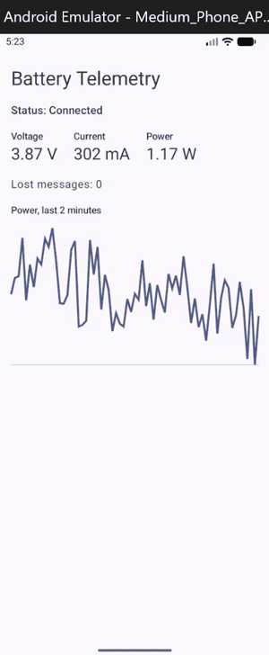

# BLE Battery Telemetry

[](https://github.com/NotRyanTM/Cuddly-Engine-AKA-ble-battery-telemetry/actions/workflows/tests.yml)

An ESP32 sensor board that measures a battery's voltage and current and sends the readings over Bluetooth Low Energy (BLE) to an Android app written in Kotlin. It is a small version of a vehicle reporting its battery status to the owner's phone.

The board, a Python bridge and the Android app all speak one 11-byte message format, defined in [docs/protocol.md](docs/protocol.md). While the board firmware is being written, a Python fake board produces messages in that same format, so the app and its tests run end to end today.



*The app in the Android emulator, connected to the Python fake board over TCP. Tapping Fast, Slow and Normal sends a 2-byte config message, and the board changes how often it sends readings (250 ms, 3 s, 1 s). Readings are simulated until the ESP32 firmware is done.*

## Status

| Part | Status |
|---|---|
| Message format ([docs/protocol.md](docs/protocol.md)) | Done |
| Python decoder and packer, with tests | Done |
| Python fake board (TCP, port 5050) | Done |
| Android app: decoder, fake and network data sources, ViewModel, screen with live power chart | Done |
| Two-way control: Fast / Normal / Slow buttons set the board's sample interval | Done (app and fake board) |
| Automated tests on every push (GitHub Actions) | Done |
| Sensor board hardware (ESP32 + INA219) | Wired, not yet powered or tested |
| ESP32 firmware | Not started |
| Python BLE bridge | Scans for devices; connecting to the board comes next |
| Android BLE data source | Not started (needs a physical Android phone) |
| Measurements (lost messages, reconnect time, accuracy) | Not started |

## How it works

Today (no board needed):

```text
fake_board.py ──11-byte readings, TCP :5050──► Android app in the emulator (NetworkTelemetrySource)
              ◄──2-byte sample interval──────  Fast / Normal / Slow buttons
```

Planned:

```text
battery + load ──► INA219 ──I2C──► ESP32 ──BLE──► Python bridge on a laptop ──TCP──► app in the emulator
                                         └──BLE──► app on an Android phone
```

The app's screens only talk to a `TelemetrySource` interface. Three versions plug into it: `FakeTelemetrySource` (made-up readings, for tests), `NetworkTelemetrySource` (reads messages over TCP; in the emulator, `10.0.2.2` is the laptop) and, later, a BLE source. Switching between them does not change the screens or the decoder.

## Message format

Each reading is 11 bytes, little-endian: version (1 byte), sequence number (2), time in milliseconds (4), voltage in millivolts (2) and current in milliamps (2, signed). In Python's `struct` notation that is `"<BHIHh"`.

The sequence number counts up by one per message, so a gap means a message was lost.

Worked example, used as a test in both Python and Kotlin: version 1, sequence 5, time 1000 ms, 3700 mV, 300 mA is `01 05 00 E8 03 00 00 74 0E 2C 01`.

The phone sends the board a 2-byte config message, a little-endian sample interval from 100 to 5000 ms (`"<H"`). For example, 1000 ms is `E8 03`. Both sides reject values outside that range, and the board keeps its current interval if it receives one.

The full specification, including the BLE UUIDs, is in [docs/protocol.md](docs/protocol.md).

## Repository layout

```text
app/       Android app (Kotlin, Jetpack Compose)
bridge/    Python decoder, fake board and BLE bridge
docs/      Message format specification
.github/   GitHub Actions workflow that runs both test suites
```

## Running it

Start the fake board (from the `bridge` folder):

```bash
python fake_board.py
```

To watch the decoded readings in a terminal instead of the app, run this in a second terminal. Add a number to send a new sample interval first, for example `python watch_board.py 250`:

```bash
python watch_board.py
```

To see them in the app, open the project in Android Studio and run it on an emulator. The app connects to the fake board at `10.0.2.2:5050` and retries every few seconds until it is running. On Android 17 it asks for local network access first.

## Testing

The tests check every layer against the same worked example, so the Python and Kotlin sides agree byte for byte.

- **Python (13 tests):** decoding the worked example, rejecting wrong lengths and unsupported versions, packing and unpacking round trips, and packing and decoding the config message, including rejecting intervals out of range.
- **Kotlin unit tests (25):** the packet parser, the fake source, the network source and the ViewModel. They cover a message split across two TCP packets, reconnecting after the server closes, counting a gap in sequence numbers as a lost message, not counting the wrap from 65535 to 0 as one, and checking that `setInterval` sends exactly `E8 03` for 1000 ms and returns false when not connected.
- **Compose UI tests (2):** the screen shows a waiting message before the first reading, then the latest reading and the lost-message count.

Python (from the `bridge` folder):

```bash
python -m pytest
```

Kotlin unit tests (from the repository root):

```bash
./gradlew testDebugUnitTest
```

GitHub Actions runs both on every push. The UI tests need an emulator and run from Android Studio.

## Hardware

- ESP32 development board
- INA219 current and voltage sensor, connected over I2C
- 4 × AA battery pack driving a power resistor load through the INA219's sense pins

The ESP32 is powered from the laptop over USB, and the battery's negative terminal shares a ground with the INA219 and the ESP32.

## Next steps

1. Write the ESP32 firmware: read the INA219, pack each reading into the 11-byte message, send it as a BLE notification, and accept the config message.
2. Extend `ble_bridge.py` to connect to the board, subscribe to notifications, forward the raw messages over TCP and pass config messages back, so the app in the emulator shows real readings.
3. Measure lost messages at different distances, reconnect time and accuracy against a multimeter, and add the results here.
4. Add a BLE data source to the app and test it on an Android phone.
