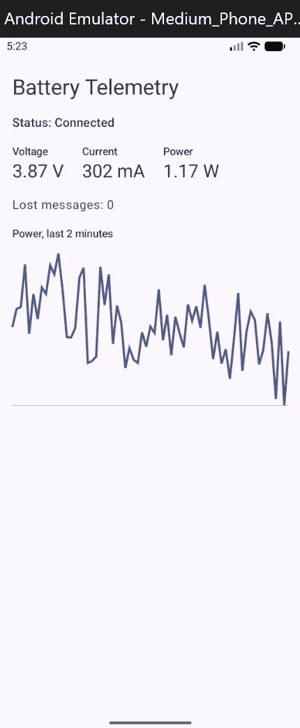
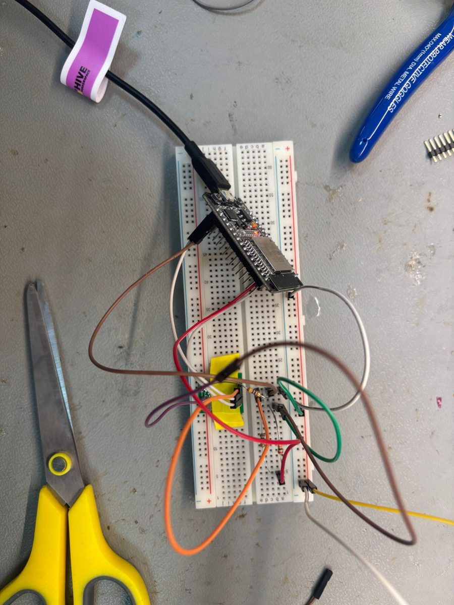

# BLE Battery Telemetry

[](https://github.com/NotRyanTM/Cuddly-Engine-AKA-ble-battery-telemetry/actions/workflows/tests.yml)

An ESP32 sensor board measures voltage and current and sends the readings over Bluetooth Low Energy (BLE) to a laptop. A Python bridge forwards them over TCP to a Kotlin Android app running in the emulator. It is a small version of a vehicle reporting its battery status to the owner's phone.

The board, the bridge and the app all speak one 11-byte message format, defined in [docs/protocol.md](docs/protocol.md). A Python fake board produces messages in that same format, so the app and its tests also run without hardware.



*The app in the Android emulator, connected to the Python fake board over TCP. Tapping Fast, Slow and Normal sends a 2-byte config message, and the board changes how often it sends readings (250 ms, 3 s, 1 s). The readings in this demo are simulated.*

## Status

| Part | Status |
|---|---|
| Message format ([docs/protocol.md](docs/protocol.md)) | Done |
| Python decoder and packer, with tests | Done |
| Python fake board (TCP, port 5050) | Done |
| Android app: decoder, fake and network data sources, ViewModel, screen with live power chart | Done |
| Two-way control: Fast / Normal / Slow buttons set the board's sample interval | Done (app and fake board) |
| Automated tests on every push (GitHub Actions) | Done |
| Sensor board hardware (ESP32 + ACS711 + voltage divider, [docs/hardware.md](docs/hardware.md)) | Built and powered from a bench supply |
| ESP32 firmware | Reads the ACS711 (GPIO34) and divider (GPIO35), sends readings over BLE, accepts the config message |
| Python BLE bridge | Connects to the board and forwards readings over TCP to the app |
| Android BLE data source | Not planned; the app reaches the board through the bridge |
| Measurements (lost messages, reconnect time, accuracy) | First check done (below); full measurements not started |

## How it works

With the real board:

```text
bench supply + load ──► ACS711 + divider ──analog──► ESP32 ──BLE──► Python bridge on a laptop ──TCP──► app in the emulator
```

Without a board:

```text
fake_board.py ──11-byte readings, TCP :5050──► Android app in the emulator (NetworkTelemetrySource)
              ◄──2-byte sample interval──────  Fast / Normal / Slow buttons
```

The app's screens only talk to a `TelemetrySource` interface. Two versions plug into it: `FakeTelemetrySource` (made-up readings, for tests) and `NetworkTelemetrySource` (reads messages over TCP; in the emulator, `10.0.2.2` is the laptop). Switching between them does not change the screens or the decoder.

## Message format

Each reading is 11 bytes, little-endian: version (1 byte), sequence number (2), time in milliseconds (4), voltage in millivolts (2) and current in milliamps (2, signed). In Python's `struct` notation that is `"<BHIHh"`.

The sequence number counts up by one per message, so a gap means a message was lost.

Worked example, used as a test in both Python and Kotlin: version 1, sequence 5, time 1000 ms, 3700 mV, 300 mA is `01 05 00 E8 03 00 00 74 0E 2C 01`.

The app sends the board a 2-byte config message, a little-endian sample interval from 100 to 5000 ms (`"<H"`). For example, 1000 ms is `E8 03`. Both sides reject values outside that range, and the board keeps its current interval if it receives one.

The full specification, including the BLE UUIDs, is in [docs/protocol.md](docs/protocol.md).

## Repository layout

```text
app/       Android app (Kotlin, Jetpack Compose)
bridge/    Python decoder, fake board and BLE bridge
firmware/  ESP32 firmware (Arduino C++)
docs/      Message format specification, hardware write-up and photos
.github/   GitHub Actions workflow that runs both test suites
```

## Running it

With the real board, upload `firmware/battery_telemetry/battery_telemetry.ino` from the Arduino IDE, then start the bridge (from the `bridge` folder). It needs `bleak`:

```bash
python ble_bridge.py
```

Without a board, start the fake board instead:

```bash
python fake_board.py
```

To watch the decoded readings in a terminal instead of the app, run this in a second terminal. Add a number to send a new sample interval first, for example `python watch_board.py 250`:

```bash
python watch_board.py
```

To see them in the app, open the project in Android Studio and run it on an emulator. The app connects to the bridge or fake board at `10.0.2.2:5050` and retries every few seconds until it is running. On Android 17 it asks for local network access first.

## Testing

The tests check every layer against the same worked example, so the Python and Kotlin sides agree byte for byte.

- **Python (13 tests):** decoding the worked example, rejecting wrong lengths and unsupported versions, packing and unpacking round trips, and packing and decoding the config message, including rejecting intervals out of range.
- **Kotlin unit tests (29):** the packet parser, the fake source, the network source and the ViewModel. They cover a message split across two TCP packets, reconnecting after the server closes, counting a gap in sequence numbers as a lost message, not counting the wrap from 65535 to 0 or a board restart as one, and checking that `setInterval` sends exactly `E8 03` for 1000 ms and returns false when not connected.
- **Compose UI tests (2):** the screen shows a waiting message before the first reading, then the latest reading and the lost-message count.

Python (from the `bridge` folder):

```bash
python -m pytest
```

Kotlin unit tests (from the repository root):

```bash
./gradlew testDebugUnitTest
```

GitHub Actions runs both on every push. The UI tests need an emulator and run from Android Studio.

## Hardware

The full hardware write-up, with photos, a schematic, design numbers, a bring-up checklist and troubleshooting, is in [docs/hardware.md](docs/hardware.md).



- ESP32 development board
- Pololu ACS711 Hall-effect current sensor carrier (±12.5 A, 110 mV/A)
- 20 kΩ / 10 kΩ voltage divider that scales the battery voltage into the ESP32's ADC range
- Bench supply at 6.0 V (Keysight U8031A) standing in for the battery, driving a 47 Ω, 5 W resistor load through the ACS711's IP+ and IP− terminals

| Signal | Connection | Firmware conversion |
|---|---|---|
| Current | ACS711 OUT → GPIO34 (D34) | (pin mV − 1650) / 110 mV per A |
| Voltage | 20 kΩ / 10 kΩ divider midpoint → GPIO35 (D35) | pin mV × 3 |

First check against the bench supply (6.0 V, 0.13 A): the best run showed about 5.94 V and 120–140 mA in the app, with readings coming through the bridge with no sequence gaps. A full accuracy check hasn't been done yet.

## Next steps

1. Measure the current sensor's zero point at startup instead of assuming 1650 mV (see [docs/hardware.md](docs/hardware.md#design-numbers)).
2. Measure accuracy at several voltages, lost messages at different distances and reconnect time, and add the results here.
3. Add link-health detection, so the app can tell a rejected message or stale data from a real disconnect.
