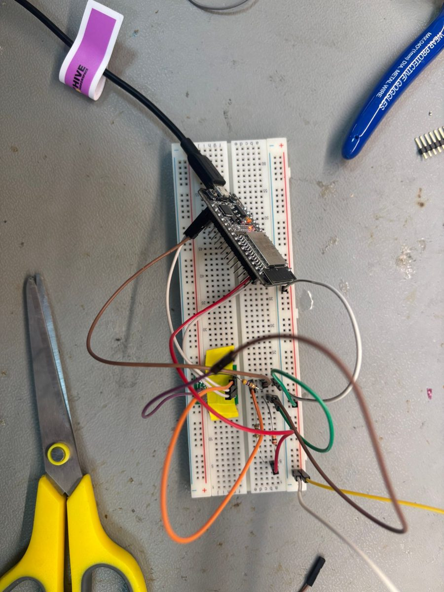
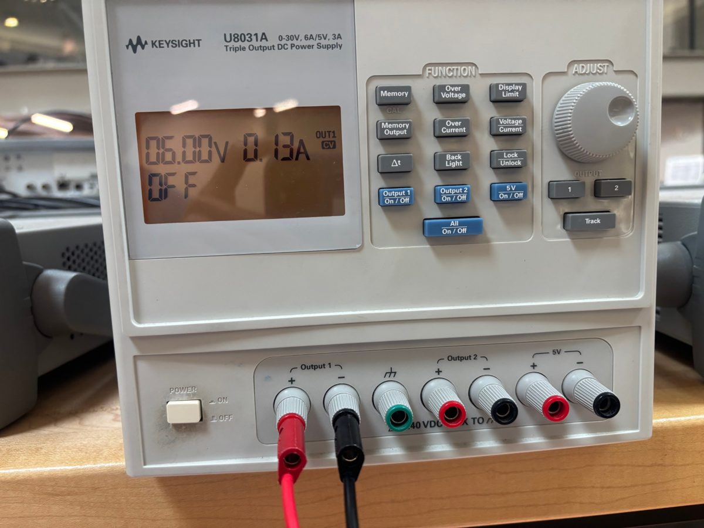

# Sensor Board Hardware

The sensor board measures a battery's voltage and current and sends the readings over BLE. For now a bench supply stands in for the battery and a power resistor stands in for the vehicle's load. Everything is on a breadboard.

<p>
  
  
</p>

*Left: the ESP32, the ACS711 carrier (under the yellow tape) and the divider resistors on the breadboard. Right: the bench supply holding 6.00 V and showing 0.13 A while the board was reporting.*

## Parts

| Part | Value / model | Job |
|---|---|---|
| Microcontroller | ESP32 dev board (Arduino board setting: ESP32 Dev Module, `esp32:esp32:esp32`) | Reads both sensors with its ADC and sends readings over BLE |
| Current sensor | Pololu ACS711 Hall-effect current sensor carrier, ±12.5 A version (110 mV/A at 3.3 V) | Measures the load current without breaking the ground path |
| Voltage divider | 20 kΩ (top) and 10 kΩ (bottom) | Scales the battery voltage down to a third so it fits the ADC |
| Load | 47 Ω, 5 W resistor | Draws a known current from the supply |
| "Battery" | Keysight U8031A bench supply, output 1 at 6.00 V | Steady, adjustable stand-in for a battery, with its own current readout to check against |
| Breadboard and jumper wires | Full-size breadboard | Holds it all together for now |
| USB cable | To the laptop | Powers the ESP32 and carries serial logs |

The firmware assumes the ±12.5 A ACS711. If the carrier is the ±25 A version, change `SENSITIVITY_MV_PER_A` in [the firmware](../firmware/battery_telemetry/battery_telemetry.ino) from 110 to 55.

## Schematic

```text
 Bench supply (+) 6.0 V
     │
     ├────────────────────► ACS711 IP+
     │                      ACS711 IP− ───► 47 Ω, 5 W load ───┐
     │                                                        │
   20 kΩ                                                      │
     │                                                        │
     ├────────────────────► ESP32 GPIO35  (voltage)           │
     │                                                        │
   10 kΩ                                                      │
     │                                                        │
 Bench supply (−) ──────────┬─────────────────────────────────┘
                            │
                       common ground ─── ESP32 GND ─── ACS711 GND

 ESP32 3V3  ───► ACS711 VCC
 ACS711 OUT ───► ESP32 GPIO34  (current)
 ESP32 USB  ───► laptop  (power and serial at 115200 baud)
```

Current flows from the supply's positive terminal into IP+, out of IP−, through the load and back to the negative terminal. Current in that direction reads as positive. If the readings come out negative, IP+ and IP− are swapped.

## Connections

| From | To | Notes |
|---|---|---|
| Supply + | ACS711 IP+ and top of the 20 kΩ | |
| ACS711 IP− | 47 Ω load | |
| 47 Ω load | Supply − | |
| 20 kΩ / 10 kΩ midpoint | ESP32 GPIO35 (D35) | Voltage sense |
| Bottom of the 10 kΩ | Ground | |
| ACS711 OUT | ESP32 GPIO34 (D34) | Current sense |
| ACS711 VCC | ESP32 3V3 | |
| ACS711 GND | ESP32 GND | |
| Supply − | ESP32 GND | The shared ground. Without it, neither reading means anything |

The ACS711's overcurrent FAULT output is not used.

### Why GPIO34 and GPIO35

Both pins are ADC1 channels (GPIO34 is ADC1_CH6, GPIO35 is ADC1_CH7). The ESP32's other ADC, ADC2, can't be read while Wi-Fi is running, so staying on ADC1 keeps the radio from ever getting in the way. Both pins are input-only, which suits a pin that only ever reads a voltage.

## How the firmware converts readings

The firmware sets the ADC to 11 dB attenuation (about 0 to 3.1 V at the pin) and uses `analogReadMilliVolts`, which applies the chip's factory calibration. Each reading throws away 4 samples, then averages 16.

| Reading | Formula | At the test point (6.00 V, 47 Ω) |
|---|---|---|
| Voltage | pin mV × 3 | 6.00 V → 2000 mV at GPIO35 |
| Current | (pin mV − 1650) ÷ 110 mV per A | 128 mA → about 1664 mV at GPIO34 |

The 4 discarded samples matter for the divider. The ADC's sampling capacitor keeps the voltage of the last pin it read, and the divider's source resistance (20 kΩ ∥ 10 kΩ ≈ 6.7 kΩ) is too high to recharge it in one sample. Without the throwaway reads, the first samples on GPIO35 would be pulled toward whatever GPIO34 last read (about 1.65 V).

## Design numbers

**Divider.** At 6 V the divider draws 0.2 mA and wastes 1.2 mW. The ESP32's ADC is most accurate between about 150 and 2450 mV at the pin with 11 dB attenuation, so this divider reads best from about 0.5 V up to about 7.3 V. A pin should never go above 3.6 V (the ESP32's 3.3 V supply plus 0.3 V), so the input must stay below about 10.8 V. This divider is fine for the 6 V test but not for a 12 V battery. That would need a larger ratio, such as 68 kΩ / 10 kΩ, which puts a charging battery's 14.4 V at about 1.85 V.

**Current.** 110 mV per amp means one ADC step (about 0.8 mV) is about 7 mA. The 16-sample average smooths that out. With the zero point at 1650 mV, the accurate 150 to 2450 mV range covers about −13.6 A to +7.3 A.

**Load.** 6.0 V across 47 Ω is 128 mA and 0.77 W, well inside the resistor's 5 W rating.

**Zero point.** The ACS711's output at 0 A is half its supply voltage, and the firmware assumes exactly 1650 mV. If the ESP32's 3.3 V rail is off by 1% (33 mV), the zero point moves about 16 mV, which reads as about 150 mA of current that isn't there. At the 128 mA test current that would be a large error, so measuring the zero point at startup is the first fix to make (see [Improvements](#improvements)).

## Bring-up checklist

1. With the supply's output off, set output 1 to 6.00 V and its current limit to about 0.3 A, so a wiring mistake can't push more than that.
2. Wire the board as in the [schematic](#schematic). Check the shared ground between the supply's negative terminal and the ESP32.
3. Plug the ESP32 into the laptop and upload [`battery_telemetry.ino`](../firmware/battery_telemetry/battery_telemetry.ino).
4. Open the serial monitor at 115200 baud. With no app connected, the board prints a `no client: ... mV, ... mA` line each interval. With the supply off, voltage should be near 0 and current near 0 mA.
5. Turn output 1 on. Expect about 6000 mV and about 128 mA. The supply should show 6.00 V and 0.13 A in CV mode.
6. Start `bridge/ble_bridge.py`, then the app. The serial monitor switches to `sent seq ...` lines.

## Troubleshooting

| Symptom | Likely cause |
|---|---|
| Current about −13,700 mA | GPIO34 is reading about 0 V. The calibrated ADC bottoms out near 140 mV, and (140 − 1650) ÷ 110 is about −13.7 A. Check the ACS711 OUT wire and the sensor's 3V3 and GND. A loose breadboard contact here caused the worst early readings. |
| Current about −128 mA instead of +128 mA | IP+ and IP− are swapped |
| A steady current offset with the supply off | The zero point isn't exactly 1650 mV (see [Design numbers](#design-numbers)) |
| Voltage near 0 with the supply on | Divider midpoint not on GPIO35, or the supply's negative terminal isn't tied to the ESP32's ground |
| Voltage reads low and moves with the current reading | The ADC is still holding the other pin's voltage. Keep the throwaway reads in `readPinMillivolts` |
| Readings jump around by hundreds of mV | Missing shared ground, or a loose jumper |
| Supply drops into CC mode | The current limit is too low for the load, or something is shorted |

## Results so far

First check against the bench supply:

| | Supply | App |
|---|---|---|
| Voltage | 6.00 V | about 5.94 V (−1%) |
| Current | 0.13 A (128 mA expected from 6.0 V ÷ 47 Ω) | 120 to 140 mA |
| Lost messages | | none (no sequence gaps through the bridge) |

The 1% low voltage reading can come from the resistors' tolerance and the ADC's calibration. Both are fixed by calibrating against the bench supply, which hasn't been done yet.

## Improvements

1. **Measure the current zero point at startup.** Average GPIO34 for a moment with no current flowing and use that instead of the fixed 1650 mV.
2. **Calibrate the voltage.** Read the board at several supply voltages (for example 3, 4.5, 6 and 7 V) and fit a gain and offset.
3. **Add 100 nF capacitors** from GPIO34 and GPIO35 to ground. They hold each pin steady while the ADC samples and filter out noise.
4. **Move to a soldered board** (perfboard or a small PCB) to get rid of loose breadboard contacts like the one on GPIO34.
5. **Resize the divider before using a 12 V battery**, so the pin stays inside the ADC's accurate range while charging.
